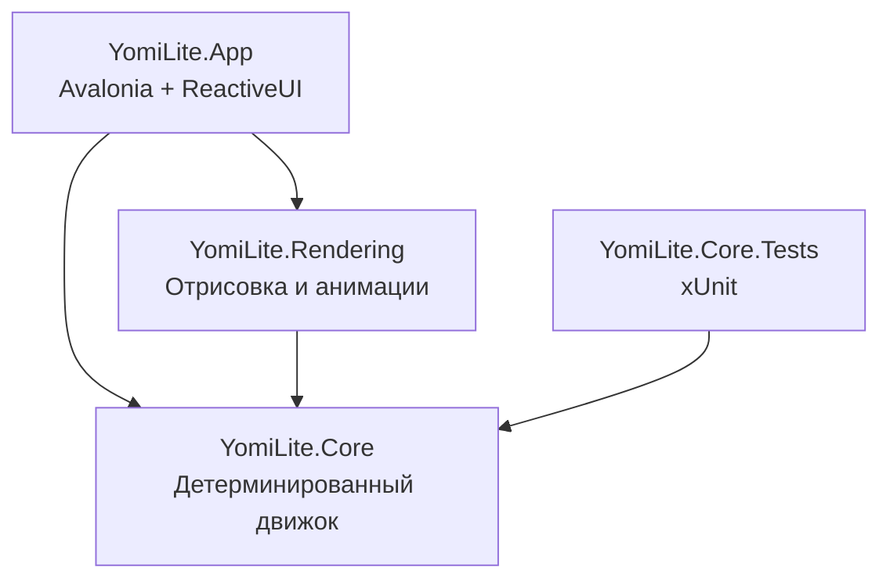
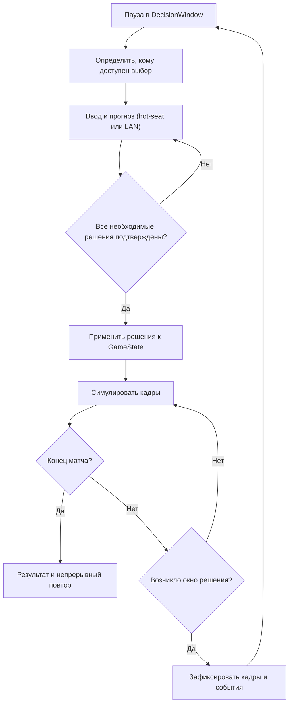

# Архитектура YOMI-Lite

## 1. Структура решения

```text
YOMI-Lite/
├── YOMI-Lite.slnx
├── global.json
├── .github/workflows/ci.yml
├── docs/
│   ├── GAME_DESIGN.md           # Правила игры
│   └── ARCHITECTURE.md          # Этот документ
├── src/
│   ├── YomiLite.Core/           # Чистая игровая модель и симуляция
│   ├── YomiLite.Rendering/      # Отображение состояний и анимаций
│   └── YomiLite.App/            # Avalonia, MVVM, навигация, управление матчем
└── tests/
    └── YomiLite.Core.Tests/     # Проверки правил и симуляции
```

Существующие проекты и ссылки уже проверены по репозиторию:



**Запрещённые зависимости:** `Core` от Avalonia, ReactiveUI, `App` или `Rendering`; `Rendering` от `App`; `Core` от тестового проекта.

**Правило ответственности:** расчёт попаданий, физических положений и доступности приёмов выполняется только в `Core`. Интерфейс управляет выбором, а графика отображает полученные результаты.

### Содержание проектов

| Проект | Принадлежащие ему компоненты | Не делает |
|---|---|---|
| `Core` | `GameState`, `FighterState`, `ActionDefinition`, `DecisionRequest`, `SimulationEngine`, правила боя, прогноз и запись кадров | Не создаёт окон, не использует UI-потоки |
| `Rendering` | `BattleView`, фигуры персонажей, позы, отображение кадров, траектории, следы ударов, эффекты | Не изменяет HP или игровые координаты |
| `App` | `MainWindow`, экраны меню/боя/результата, ViewModel, `MatchCoordinator`, скрытый ввод, управление повторами | Не определяет победителя или физику |
| `Core.Tests` | Тесты кадров, попаданий, состояния, ресурсов, повтора, прогноза | Не зависит от UI |

> Сейчас `Rendering` — обычная библиотека .NET без пакетов Avalonia. Когда начнётся отрисовка, добавляем в неё необходимые пакеты Avalonia. Это не требует менять границы остальных проектов.

## 2. Базовые понятия

- **Игровой кадр (`FrameIndex`)** — целое число: один шаг симуляции. Целевая частота — 60 игровых кадров/с. Скорость интерфейса на частоту расчёта не влияет.
- **Ход (`TurnIndex`)** — точка принятия решения, в которой остановлена симуляция. Один ход может охватывать несколько игровых кадров до следующей точки выбора. Не считать один ход одним кадром.
- **Окно решения (`DecisionWindow`)** — набор персонажей и разрешённых им решений в конкретном кадре. Окно может быть обычным (новый приём), реактивным (DI/Burst), отменой (Free Cancel) или комбинацией таких возможностей.
- **Действие (`Action`)** — удар, перемещение, защита и т. п. Содержит длительность и параметры, может продолжаться во время нескольких ходов.
- **Состояние (`GameState`)** — всё, что необходимо, чтобы продолжить расчёт без обращения к UI.
- **Снимок кадра (`FrameSnapshot`)** — неизменяемый результат расчёта для графики и повтора.

### Важное свойство оригинальной механики

Если один боец завершил приём раньше второго, **решение может получать только первый**: второй продолжает своё действие. Однако второй тоже может получить право выбора, если сработало отдельное правило (например, Free Cancel или реакция на попадание). В интерфейсе всегда показываются `Ход N`, `Кадр F`, «Кто выбирает» и причина остановки.

## 3. Состояние боя

```text
GameState
  FrameIndex, TurnIndex
  MatchStatus: Planning | Simulating | Finished
  ArenaState: пол, левая/правая границы
  Fighter[2]
  PendingDecisionWindow
  Winner / Draw (при завершении)

FighterState
  Id: Player1 | Player2
  Position, Velocity, Facing, Grounded
  Health, SuperMeter
  CurrentMove, MoveFrame, MovePhase
  HitstunFrames, BlockstunFrames, KnockdownState
  BurstAvailable, FreeCancelCharges, AirOptionsRemaining
  DISelection
  ComboState (счётчик, коэффициент урона)
  AttackHitRegistry (цели, уже поражённые текущей атакой)
```

Числа времени — целые кадры, а не `DateTime`/`Task.Delay`. Для позиции и скорости предпочтительно фиксированное представление (например, целые «тысячные доли игровой единицы»), чтобы не зависеть от особенностей округления на разных платформах. Окончательное разрешение координат — решение игрового баланса и физики.

Общее состояние содержит **исчерпывающие** данные для продолжения симуляции. `Core` не должен получать скрытые игровые значения из ViewModel или из анимации.

## 4. Описание приёмов и решений

Приёмы описываются данными, а не отдельным `if` для каждой кнопки:

```text
ActionDefinition
  Id, DisplayName, Category
  AllowedStates (Ground / Air / Other)
  StartupFrames, ActiveFrames, RecoveryFrames
  Damage, Hitstun, Blockstun, Knockback
  HitboxTimeline, HurtboxTimeline
  ResourceCost, CancelRules
  ParamSchema (допустимые настройки направления/силы)
```

Начальный набор: шаг/рывок, параметризованный прыжок, Air Dash, быстрый и сильный удары, подсечка, апперкот, воздушный удар, захват, высокий/низкий блок, уклонение, ожидание, один суперприём. DI, Burst и Free Cancel — **контекстные решения**, а не всегда видимые атакующие кнопки.

Три составляющие API:

1. `GetAvailableChoices(GameState, PlayerId)` — единственный источник допустимых действий для интерфейса.
2. `ValidateChoice(GameState, PlayerId, DecisionChoice)` — проверка параметров, текущих фаз и ресурсов.
3. `ApplyChoicesAndSimulate(GameState, IReadOnlyList<DecisionChoice>)` — применение подтверждённых выборов и расчёт до ближайшего окна решения либо конца боя.

`DecisionChoice` — логический тип с вариантами `StartMove`, `Continue`, `FreeCancel`, `ReactWithDI`, `Burst`; у каждого варианта есть только допустимые для него параметры. Например, `StartMove(Jump, Direction, Strength)` и `ReactWithDI(Direction)`. Нельзя разрешать несовместимые варианты одной реакцией без отдельного правила.

## 5. Игровой цикл



**На каждой остановке:**

1. Движок формирует `DecisionWindow` с причинами (`Ready`, `FreeCancelOpportunity`, `HitReaction`, `HitCancelOpportunity`, `BurstOpportunity`).
2. `MatchCoordinator` получает разрешённые решения и собирает подтверждения **только у тех участников, у кого открыто окно**.
3. В hot-seat ввод выполняется последовательно: игрок 1 подтверждает → экран передачи управления → игрок 2 подтверждает (если нужен). В LAN каждый выбирает на своём устройстве, команды собирает хост. В обоих случаях выбор скрыт до разрешения окна.
4. Оба подтверждённых решения применяются **в одном и том же игровом кадре**, без преимущества от порядка ввода.
5. `Core` симулирует до нового окна или до завершения, отдавая снимки и события для графики и истории боя.
6. Увеличивается `TurnIndex`, отображается номер хода и текущий кадр.

При наличии только одного участника окна не требуется фиктивное подтверждение второго.

### Внутренний порядок обработки одного кадра

1. Продвинуть фазы ранее выбранных приёмов и применить параметры движения.
2. Рассчитать движение, гравитацию, контакт с полом/стенами и разворот.
3. Обновить hitbox/hurtbox для текущих фаз.
4. Вычислить **все** контакты и защиты из одного промежуточного состояния.
5. Применить столкновения, урон, оглушение и отбрасывание **одновременно** (чтобы Player1 не выигрывал из-за порядка массивов).
6. Обновить ресурсы, комбо, состояния, доступность новых решений.
7. Создать `FrameSnapshot` и список `CombatEvent`.
8. Если возникло новое окно выбора — остановить симуляцию после этого кадра.

Должно быть зафиксировано, что означает «кадр 0» и в каком кадре начинается `Startup`: на уровне тестов нельзя допускать ошибок на один кадр.

## 6. Окна решений для продвинутых механик

**DI.** После получения удара в окне реакции разрешено изменить направление влияния на последующее отбрасывание. Выбранное направление действует по определённому правилу до следующей реакции. При каждом значимом новом попадании может открываться новое окно — но не на каждом кадре `Hitstun`.

**Burst.** В разрешённом окне реакции оглушённый боец может потратить доступный заряд и начать защитное действие Burst. Это действие имеет собственную фазу и столкновения; оно не «телепортирует» бойца автоматически в безопасность. Возможность контрприёма сохраняется.

**Free Cancel.** Если во время исполнения длинного приёма наступила предусмотренная правилами возможность отмены, игрок выбирает `Continue` или `FreeCancel(NextMove)`; заряд списывается только при подтверждённой отмене. Отказ от отмены в этом окне **не должен** вызывать ту же паузу повторно в том же кадре.

**Hit Cancel.** После подтверждённого попадания движок проверяет разрешённый переход к следующему приёму и создаёт одно окно выбора по правилу конкретной атаки.

**Air Options.** Прыжок/рывок тратит ресурс согласно правилам; при приземлении ресурс восстанавливается. UI не предлагает Air Dash, когда ресурс исчерпан.

Все эти возможности генерируются движком как `DecisionWindow`; ViewModel не вычисляет их самостоятельно.

## 7. Прогнозирование

Прогноз — это **реальный движок на копии состояния**, а не отдельная система «предположительных правил».

```text
PredictionRequest
  BaseState (глубокая копия текущего публичного состояния)
  HypotheticalChoices (мой вариант + предполагаемый вариант соперника)
  FrameLimit / StopAtNextDecision

PredictionResult
  FrameSnapshots[]
  CombatEvents[]
  EndpointDecisionWindow
  Truncated (если достигнут безопасный лимит)
```

Требования:

- Никаких изменений реального `GameState` при просмотре прогноза.
- После подтверждения действия игрока 1 его **настоящий** выбор не передаётся в прогноз игроку 2: второй может указать только собственную гипотезу о выборе соперника.
- Действия противника, уже начатые в предыдущих кадрах, считаются известным состоянием, если их нельзя отменить; доступные отмены рассматриваются как гипотезы.
- При совпадении гипотетических и фактических выборов история кадров и боевых событий до следующей точки выбора должна совпасть.
- Для длинного прогноза есть ограничение по кадрам и возможность отменить вычисление. Сначала достаточно синхронного расчёта короткого участка; если он тормозит UI, вынести **расчёт прогноза** в `Task` с `CancellationToken` и защитой от устаревших ответов.

**Не прогнозировать дерево всех возможных ходов**: игрок вручную перебирает предполагаемые действия соперника; сложность не растёт экспоненциально.

## 8. История боя и воспроизведение

```text
MatchRecord
  RulesetVersion
  InitialState
  DecisionLog[] (Frame, PlayerId, Choice)
  FrameSnapshots[] (кадр → состояние изображения)
  CombatEvents[] (Hit, Block, Parry, Clash, Burst, KO ...)
```

Для первой законченной версии записывать кадры реального боя в память. `ReplayController` в `App` перемещает указатель по `FrameSnapshots` со скоростью 0.5× / 1× / 2×, умеет ставить паузу и переходить к произвольному кадру. `Rendering` рисует тот же снимок и в обычном бою, и в повторе.

Запись `DecisionLog` также нужна для тестов повторного прогона и диагностики, но готовый повтор **не должен зависеть от повторного расчёта**: если поменяется баланс приёмов, записанные кадры всё равно воспроизводятся в точности. Сохранение повтора на диск — отдельное решение, не обязательное для первого работающего матча.

## 9. Интерфейс и интеграция

В `YomiLite.App`:

```text
App.axaml / MainWindow
  Navigation / Screens
    MainMenuView + ViewModel
    BattleView + BattleViewModel
    HandoffView + ViewModel
    LanLobbyView + ViewModel
    ResultsView + ViewModel
    ReplayView + ViewModel
  MatchCoordinator
  MatchSession (локальная или сетевая)
  PredictionController
  ReplayController
```

`MatchCoordinator` — **оркестратор пользовательского сценария**, а не второй игровой движок. Он работает через сессию матча: получает актуальное публичное состояние, собирает локальный ввод, решает, чей экран показать, и публикует снимок для UI/Renderer. В локальной сессии и на хосте авторитетный расчёт выполняется через Core; клиент получает результат хоста. Правила боя не зависят от режима. Не копирует в себя правила ходов.

Интерфейс боя показывает: номер хода и кадра, кто принимает решение, статус готовности, здоровье/ресурсы, доступные действия с названиями, параметры движения и прыжков, прогноз, кнопку подтверждения и подсказки. Контекстные решения DI/Burst/Free Cancel отображаются только когда разрешены. В режиме передачи управления скрываются текущий выбор и результат гипотетического прогноза предыдущего игрока.

В `Rendering` достаточно одного кастомного `BattleSceneControl` Avalonia, принимающего `FrameSnapshot` / `PredictionResult` и выполняющего `Render(DrawingContext)`. Позы бойцов можно вычислять из `AnimationState` и `MoveFrame` снимка; анимация **не управляет** хитбоксами. Отрисовка на первом этапе — процедурная геометрия; система позволяет заменить визуальный стиль позднее без изменения `Core`.

### 9.1. Сессии матча и LAN (предлагаемый контракт)

Сохраняем четыре существующих проекта. Для начала транспорт и реализацию сессий размещаем в отдельном каталоге `App/Multiplayer`; при необходимости позже выделим библиотеку `YomiLite.Networking`. Ни Core, ни Rendering не зависят от сокетов. `MatchCoordinator` использует общий контракт сессии, а не отдельный игровой цикл на каждый режим.

| Компонент | Ответственность |
|---|---|
| `IMatchSession` | Начало матча, текущее публичное состояние/окно, подтверждение локального решения, уведомление о готовности, получение рассчитанного участка и завершение сессии |
| `LocalMatchSession` | Оба игрока на одном ПК, общий буфер скрытых команд, вызов Core |
| `LanHostSession` | Подключение одного клиента, хранение команд до разрешения окна, валидация и авторитетная симуляция Core |
| `LanClientSession` | Подключение к хосту, отправка своей подтверждённой команды, получение результатов и публичного состояния; локальный Core для прогноза |

Для LAN предлагается TCP с `TcpListener` / `TcpClient`, сообщения JSON через `System.Text.Json` с префиксом длины и ограничением размера сообщения; сериализуются явные DTO, а не ViewModel или произвольные внутренние объекты. Конкретные сигнатуры уточняются в Draft PR; протокол ниже задаёт необходимую семантику.

| Сообщение | Направление | Содержание |
|---|---|---|
| `Hello` / `Welcome` | Клиент ↔ хост | Версия протокола и правил, назначенный игрок, идентификатор матча |
| `MatchStarted` | Хост → клиент | Начальное публичное состояние и окно решений |
| `SubmitChoice` | Клиент → хост | MatchId, TurnIndex, FrameIndex, PlayerId, подтверждённый DecisionChoice |
| `ReadyStatus` | Хост → клиент | Кто подтвердил, без самих команд |
| `TurnResolved` | Хост → клиент | Идентификатор разрешённого окна, публичные применённые команды, снимки/события участка, новое публичное состояние и следующее окно или результат матча |
| `Error` / `SessionEnded` | Обе стороны по необходимости | Отклонение команды, ошибка версии/связи или завершение сессии |

Хост принимает только решение игрока, назначенного этому подключению; проверяет номер окна, доступность решения и параметры, отвергает повторные/устаревшие команды. Если несколько реакций возникают на одном кадре, идентификатор окна должен отличать их (предлагается монотонный TurnIndex в пределах MatchId). Одно подтверждение фиксирует выбор для соответствующего окна; при отклонении команда не считается принятой. Хост не отправляет скрытые команды до разрешения окна и не включает их в публичный GameState. Прогноз использует публичное состояние и гипотезы. У хоста как доверенной стороны технически есть доступ к буферу команд; криптографическая защита от нечестного хоста не входит в MVP.

Авторитетный хост рассчитывает бой один раз, оба экземпляра воспроизводят один набор кадров/событий и сохраняют одинаковый MatchRecord. Не нужна синхронизация на каждом кадре по сети, rollback или отдельный сервер. При несовместимой версии подключение отклоняется; при разрыве матч завершается с понятным сообщением без продолжения на неподтверждённых командах. Сетевой ввод-вывод асинхронный, не блокирует UI; операции подключения и чтения отменяемы. Реванш требует подтверждения обоих и нового MatchId.

Порядок реализации: сначала вертикальный сценарий локального боя (§11), затем минимальный LAN-сценарий с теми же командами, кадрами и повтором. Проверить loopback и два компьютера. Сеть не должна менять боевые правила.

## 10. Детерминизм и безопасность состояния

- `Core` не использует UI, файловую систему, часы ОС, задержки, случайные значения без фиксированного seed или глобальное изменяемое состояние.
- Движок обрабатывает один кадр логически последовательно. Параллельный расчёт не требуется; он усложнит воспроизводимость.
- Входные команды всегда проверяются в `Core`; некорректное действие не изменяет состояние.
- `FrameSnapshot`, `DecisionWindow` и `CombatEvent` после публикации неизменяемы. Графика не получает ссылки на изменяемый внутренний `FighterState`.
- Каждой атаке соответствует реестр поражённых целей, предотвращающий повторное нанесение урона на каждом активном кадре без специального свойства мультиудара.
- Приоритеты одновременного попадания, блокирования, захвата, Burst и Clash — часть единых правил столкновений; нельзя рассчитывать сначала игрока 1, затем игрока 2.
- Механизмы защиты от зацикливания: лимит кадров на расчёт до нового решения, ограничение длительности матча и гарантия продвижения игрового времени после `Wait`/`Continue`.

## 11. Минимальные контракты для параллельной работы

Перед разработкой нужно согласовать **публичные типы**, а не полную реализацию:

| Контракт | Откуда → куда | Для чего |
|---|---|---|
| `GameState` (внутренний) | `Core` | Авторитетное состояние |
| `DecisionWindow`, `AvailableChoice` | `Core` → `App` | Кому и что можно выбрать |
| `DecisionChoice` | `App` → `Core` | Подтверждённая команда |
| `SimulationResult` | `Core` → `App` | Новое состояние, кадры и события |
| `FrameSnapshot` | `Core` → `Rendering` | Отрисовка боя и повтора |
| `PredictionResult` | `Core` → `Rendering`/`App` | Траектории, прогноз попаданий |
| `MatchRecord` | `Core` → `App` | Просмотр результатов и повтора |

Для сессии матча дополнительно согласовать типы: публичная полная копия состояния для локального прогноза (без буфера скрытых выборов), `ChoiceSubmission` (идентификатор матча/окна и игрока + команда), результат разрешённого окна и статус готовности. `FrameSnapshot` не заменяет полное состояние для расчёта прогноза: он предназначен для рисования и повтора.

**Что нужно показать в прототипах C# до закрытия Issue #2:**

- Явные типы `GameState`, `FighterState`, `DecisionWindow`, `AvailableChoice`, `DecisionChoice`, `SimulationResult`, `FrameSnapshot`, `CombatEvent`, `PredictionRequest/Result`, `MatchRecord`; идентификатор владельца каждой команды и окна, набор доступных решений и правила объединения реакций.
- Согласованную систему координат/единиц, неизменяемые публикуемые снимки, независимую копию состояния для прогноза, формат событий и снимков, достаточный для Rendering.
- Согласовать расхождения с GDD: `BurstAvailable` должен отражать шкалу 0–100 (доступность производная); Air Dash тратит воздушную возможность, обычный прыжок начинает воздушный цикл; Free Cancel требует хранения отметки приёма и выбора Hold/Cancel; Hit Cancel имеет собственное основание доступности следующего действия. Не фиксировать числовой баланс в UI.
- Прототип API Core для получения окна, проверки набора команд и расчёта участка; черновой общий контракт сессии для двух режимов. Полная реализация механик и транспорта пока не нужна. Достаточно собрать решение и показать пример стыковки типов; конкретные сигнатуры согласовать ревью.

Только `Core` задаёт систему координат, направление `Facing`, порядок кадров, значения enum и условия готовности. Типы не должны ссылаться на `Brush`, `Control`, `Dispatcher` или `ReactiveObject`.

### Первый совместимый вертикальный сценарий

1. Два бойца стоят на арене; `Core` возвращает `DecisionWindow` для обоих.
2. `App` принимает `Walk` от первого и `Walk` от второго, скрывая первый выбор.
3. `Core` рассчитывает несколько кадров и возвращает `FrameSnapshot[]` и следующее окно решений.
4. `Rendering` рисует новые позиции; `App` показывает номер хода/кадра.
5. `ReplayController` воспроизводит те же снимки в реальном времени.

Этот сценарий нужен для интеграции **до** сложных атак, DI и Burst. Он не является полным MVP игры, а проверяет стыковку компонентов.

## 12. Тестирование

Проверять не только компиляцию, но и свойства механики:

| Тест | Ожидаемый результат |
|---|---|
| Один и тот же `GameState` + выборы | Одинаковая история кадров/событий |
| Прогноз совпадает с настоящими выборами | Тот же результат до следующего окна |
| Одновременно активные атаки | Результат не зависит от порядка игроков в коллекции |
| Восстановление приёма позже соперника | Окно только для готового либо для разрешённой отмены |
| Удар и защита | Корректные hitstun/blockstun, без двойного урона |
| DI во время реакции | Влияет на физику, но не разрешает запрещённый приём |
| Free Cancel без заряда | Отклонён без изменения состояния |
| Burst | Заряд тратится один раз, окно открывается по правилам |
| Air Dash после расходования Air Options | Недоступен до восстановления |
| Replay | Число кадров и визуальное состояние равны записи матча |
| Передача управления на одном ПК | Выбор первого не виден во время ввода второго |
| LAN: одинаковое разрешение окна | Одинаковое публичное состояние, снимки и история на обоих устройствах |
| LAN: неверная/повторная команда | Отклоняется без изменения состояния и лишнего продвижения |
| LAN: отключение и версия | Понятная ошибка; матч не продолжает симуляцию по фиктивной команде |
| Временные границы боя | Симуляция не зацикливается и корректно определяет конец матча |

В GitHub Actions остаются сборка и `dotnet test` для всего решения. Позже — адресные тесты соответствующих приёмов; не нужно вводить тяжёлую тестовую инфраструктуру до появления настоящего кода.

## 13. Границы и вопросы для фиксации в GDD

**В рамках целевой игры:** два игрока в hot-seat или LAN, один тип бойца, одна арена, покадровая симуляция, прогнозы, DI/Free Cancel/Burst/Hit Cancel/Parry/Clash/Air Options, воздушный бой, комбо, один суперприём, визуальные эффекты, полный повтор.

**Вне текущего объёма:** интернет-сервисы, matchmaking, rollback, выделенный сервер, восстановление прерванного матча, ИИ, разные классы, редактор персонажей, система модов, множественные арены, запись повтора в облако.

Требуют отдельной таблицы правил и чисел в `GAME_DESIGN.md`, **не должны выдумываться при реализации интерфейса**:

- Точные характеристики всех приёмов и физические параметры прыжка/рывка.
- Какие окна и в какой фазе открывают Free Cancel, Hit Cancel, DI и Burst; стоимость и восстановление ресурсов.
- Поведение Clash, взаимного попадания, захвата и парирования при одновременности.
- Порог и условия завершения комбо, масштабирование урона и отбрасывания.
- Временной лимит матча, борьба с пассивной игрой, победа при тайм-ауте и ничья.
- Что входит в одну «готовность к действию» при приземлении, падении и вставании.

**Правило согласования:** архитектура определяет *где* вычисляются эти вещи и *какие данные* передаются; конкретные численные и балансные правила задаёт GDD. Без этого новые механики будут реализовываться несовместимо.
